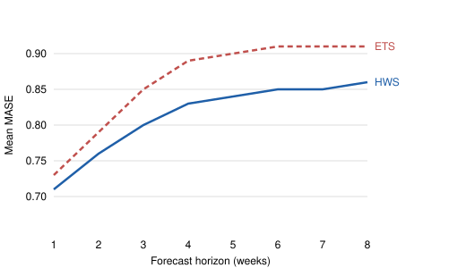

# Abstract

Ferry operators plan crews and sailings from forecasts of weekly passenger numbers, which depend on the season and on how busy the departure harbour is. We propose harbour-weighted exponential smoothing (HWS), a state space model that adds to exponential smoothing a harbour weight $\eta$, the share of a route's passengers explained by the traffic of its departure harbour. On 48 routes of Aldmoor Ferries, observed weekly from 2015 to 2023, HWS had a mean MASE of 0.812 over horizons 1 to 8 weeks, against 0.861 for ETS and 0.893 for the seasonal naive method. In simulations, the harbour weight was recovered with a mean absolute error of 0.031 when the series had at least 156 weeks of data.

# 1. Introduction

Weekly passenger numbers on a ferry route follow the season, but they also move with the harbour: when a harbour is busy with other routes, travellers shift between sailings. Exponential smoothing (Hyndman et al., 2008) models each route alone and misses this shared movement. We add one parameter, the harbour weight, which links each route to the total traffic of its departure harbour.

The paper makes three contributions. First, it defines HWS and its state space form. Second, it shows by simulation that the harbour weight is identifiable when the series is long enough. Third, it compares HWS with ETS and the seasonal naive method on 48 routes.

# 2. The model

Let $y_t$ be a route's passengers in week $t$ and $h_t$ the total passengers of its departure harbour in week $t$, all routes included. HWS with additive error is

$$
\begin{aligned}
y_t &= \ell_{t-1} + s_{t-52} + \eta\,(h_{t-1} - \bar h_{t-1}) + \varepsilon_t \\
\ell_t &= \ell_{t-1} + \alpha \varepsilon_t \\
s_t &= s_{t-52} + \gamma \varepsilon_t
\end{aligned}
$$

where $\ell_t$ is the level, $s_t$ the weekly seasonal component with period 52, $\bar h_{t-1}$ the mean harbour traffic over the previous 52 weeks, $\alpha$ and $\gamma$ the smoothing parameters, and $\varepsilon_t$ an error with mean zero and variance $\sigma^2$. The harbour weight $\eta$ lies in $[0, 1]$ in all our estimates, although the model does not require it.

The parameters are estimated by maximising the likelihood under normal errors. The point forecast $k$ weeks ahead ($k \le 52$) uses the last observed harbour deviation:

$$\hat y_{t+k|t} = \ell_t + s_{t+k-52} + \eta\,(h_t - \bar h_t).$$

# 3. Simulation

We simulated 1,000 series from HWS for each of three lengths (104, 156 and 260 weeks), with $\alpha = 0.2$, $\gamma = 0.1$ and $\eta$ drawn uniformly from $[0.1, 0.6]$, and estimated the model on each series. Table 1 gives the mean absolute error of the estimated harbour weight.

| Series length (weeks) | Mean absolute error of $\hat\eta$ | Share of estimates within 0.05 of $\eta$ |
|---|---|---|
| 104 | 0.084 | 41% |
| 156 | 0.031 | 79% |
| 260 | 0.018 | 92% |

Table: Table 1. Estimation of the harbour weight in simulations, 1,000 series per length.

With two years of data the harbour weight is poorly estimated; from three years on it is recovered well.

# 4. Application to Aldmoor Ferries

## 4.1 Data

Aldmoor Ferries runs 48 routes from 6 harbours. We use weekly passenger numbers from the first week of 2015 to the last week of 2023 (469 weeks per route). Weeks in which a route did not sail (strikes, storms) were filled with the mean of the two neighbouring weeks; this affected 1.7% of route-weeks. The data are commercial and cannot be shared.

## 4.2 Evaluation

We used rolling-origin evaluation with 26 origins in 2023, forecasting 1 to 8 weeks ahead from each origin, and compared HWS with ETS (selected by AICc) and the seasonal naive method. Accuracy is measured by the mean absolute scaled error (MASE), scaled by the in-sample seasonal naive error.

| Method | Mean MASE | Median MASE | Mean MASE, winter origins |
|---|---|---|---|
| HWS | 0.812 | 0.774 | 0.791 |
| ETS | 0.861 | 0.809 | 0.874 |
| Seasonal naive | 0.893 | 0.851 | 0.902 |

Table: Table 2. Accuracy on the 48 Aldmoor routes, horizons 1 to 8 weeks, 26 origins in 2023. Winter origins are those from November to February (9 of the 26).

HWS had the lowest mean and median MASE. Its advantage over ETS was larger at winter origins (0.791 against 0.874) than over the whole year. The estimated harbour weights ranged from 0.04 to 0.57, with a median of 0.22; routes from the two largest harbours had the highest weights.

Figure 1 shows that the gap between HWS and ETS widens from horizon 1 to horizon 4 and stays roughly constant after that.

# 5. Discussion

HWS uses information that ferry operators already have, the traffic of each harbour, and adds a single parameter. The gain over ETS is largest when harbours are busy with many routes and in winter, when sailings are fewer and travellers move between them.

## 5.1 Limitations

All 48 routes come from one operator, in one region. The model needs at least three years of weekly data for the harbour weight to be estimated well (Section 3); we did not evaluate routes with less. Forecasts use the last observed harbour traffic, so a sudden change in a harbour (a new route, a closure) is not anticipated. We evaluated weekly data only.

# References

Gardner, E. S. (1985). Exponential smoothing: The state of the art. *Journal of Forecasting*, 4(1), 1–28.

Hyndman, R. J., Koehler, A. B., Ord, J. K., and Snyder, R. D. (2008). *Forecasting with Exponential Smoothing: The State Space Approach*. Springer.

Hyndman, R. J., and Koehler, A. B. (2006). Another look at measures of forecast accuracy. *International Journal of Forecasting*, 22(4), 679–688.
